<h1 align="center">shelfdrop</h1>

<p align="center">
  Find manga, books and audiobooks, download them, and shelve them in Jellyfin under the name of their French edition.
</p>

<p align="center">
  <a href="LICENSE"></a>
  
  
</p>

shelfdrop sits next to Prowlarr, a torrent client and Jellyfin on a media server. Type a title: it finds the work in eight metadata sources, searches its releases in Prowlarr under every name the work is published under, sends the ones you pick to the torrent client, then renames and files the downloaded volumes in your Jellyfin libraries, with their metadata. A web page drives it all; an API and an MCP server let a script or an assistant do the same.

## Screenshots

<p align="center">
  <a href="docs/screenshots/search-releases.webp">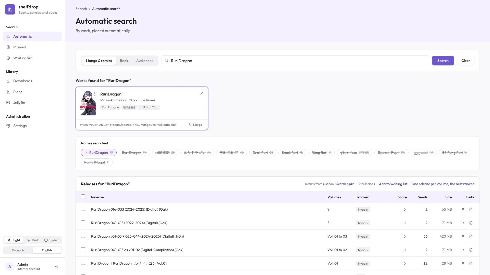</a>
  <br><sub>The releases of a work, searched in Prowlarr under each of its names, scored and ranked.</sub>
</p>

<table>
  <tr>
    <td width="50%"><a href="docs/screenshots/search-works.webp">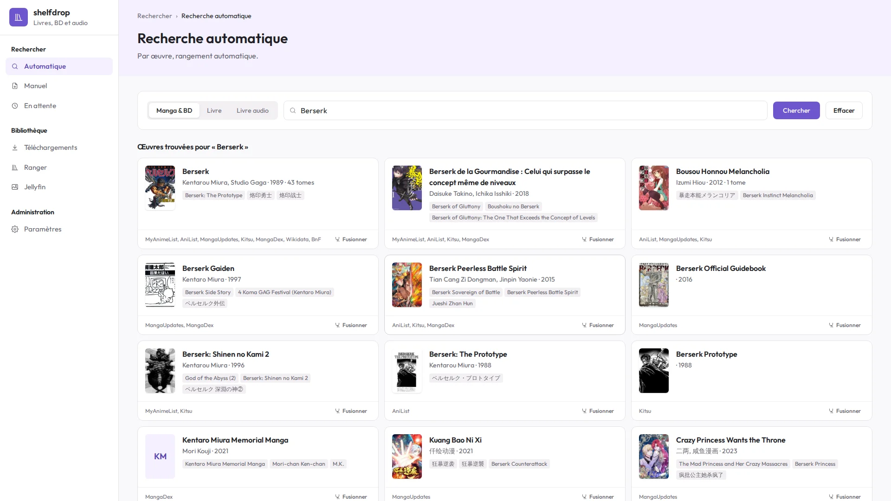</a><br><sub>Work search: one result per work, from every source, with its names</sub></td>
    <td width="50%"><a href="docs/screenshots/downloads.webp">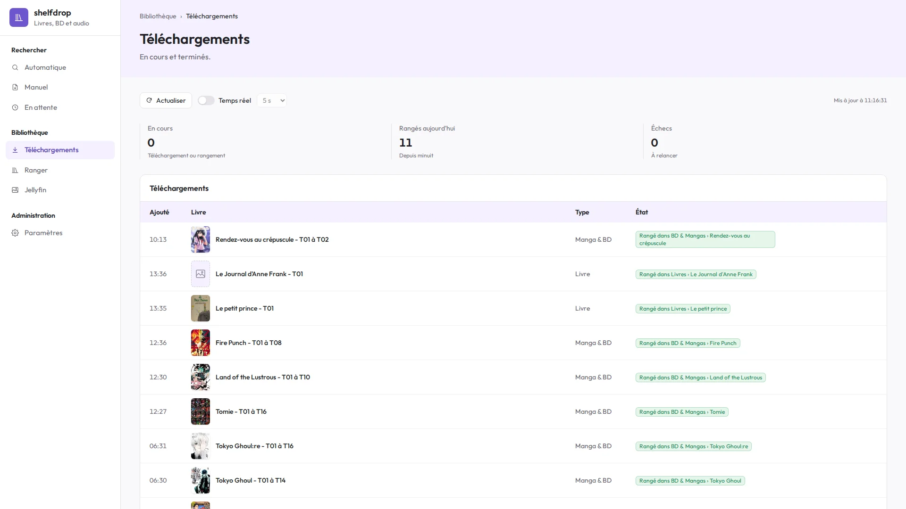</a><br><sub>Downloads, followed live, and where each was shelved</sub></td>
  </tr>
  <tr>
    <td width="50%"><a href="docs/screenshots/jellyfin-series.webp">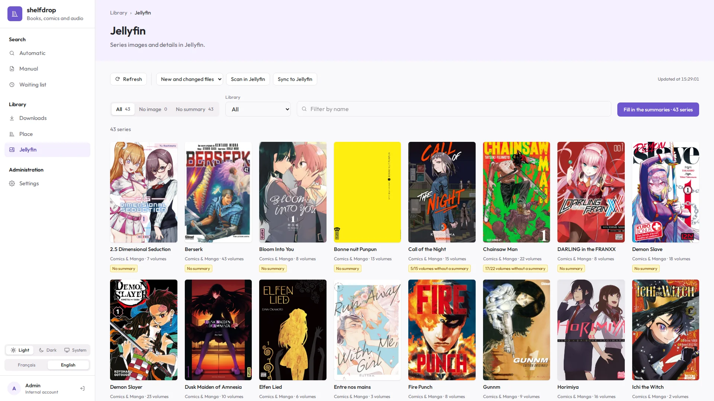</a><br><sub>Jellyfin page: the series of the libraries</sub></td>
    <td width="50%"><a href="docs/screenshots/jellyfin-series-dialog.webp">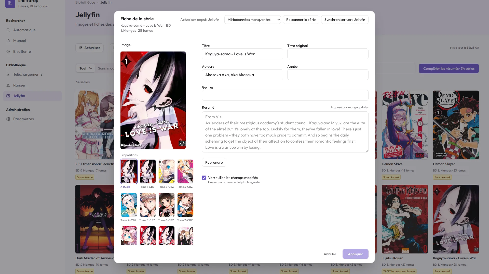</a><br><sub>A series: its metadata, covers proposed by the sources, its volumes</sub></td>
  </tr>
  <tr>
    <td width="50%"><a href="docs/screenshots/ranger.webp">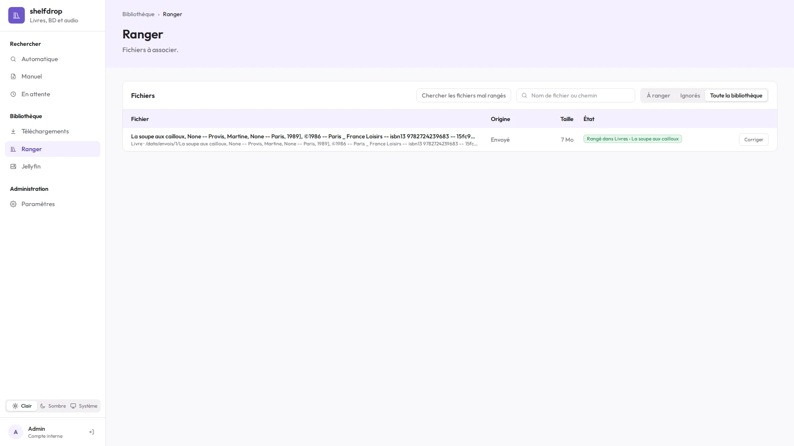</a><br><sub>Ranger: the files to link by hand, and every file of the library</sub></td>
    <td width="50%"><a href="docs/screenshots/waiting-list.webp">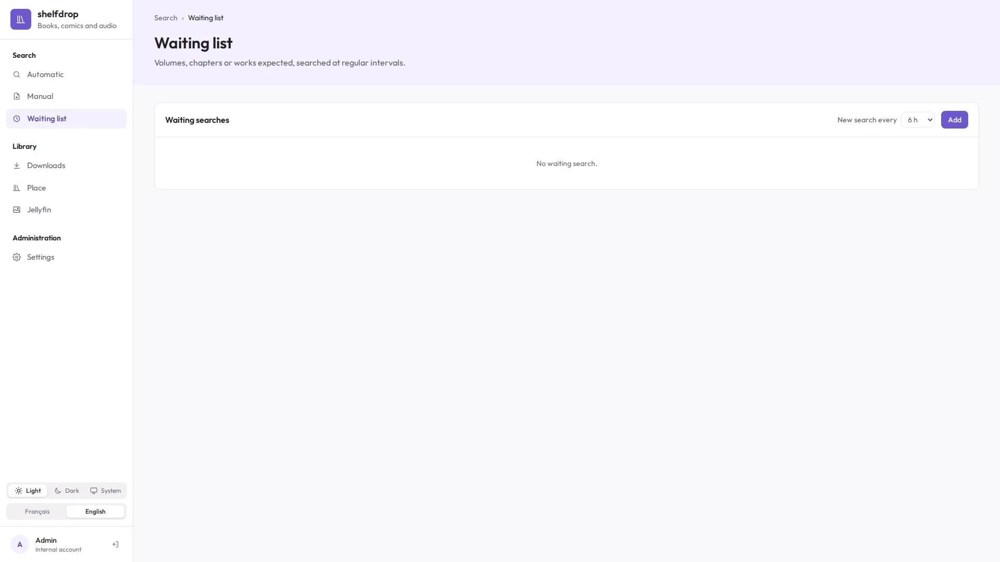</a><br><sub>Waiting list: searches run again until a release shows up</sub></td>
  </tr>
  <tr>
    <td width="50%"><a href="docs/screenshots/settings-services.webp">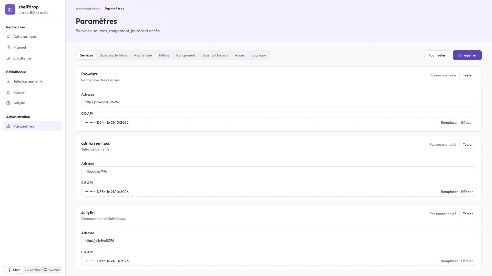</a><br><sub>Settings: Prowlarr, qBittorrent through qui, Jellyfin</sub></td>
    <td width="50%"><a href="docs/screenshots/settings-logs.webp">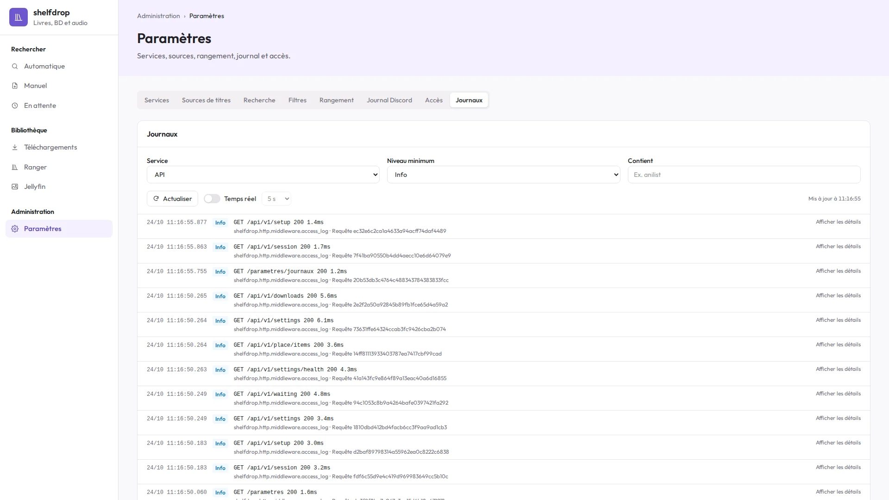</a><br><sub>Settings: the logs of the API and of the placement worker</sub></td>
  </tr>
  <tr>
    <td width="50%"><a href="docs/screenshots/sign-in.webp">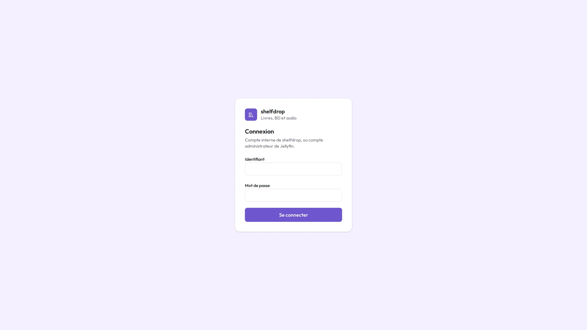</a><br><sub>Sign-in: the internal account or a Jellyfin administrator</sub></td>
    <td width="50%"></td>
  </tr>
</table>

On a phone:

<p align="center">
  <a href="docs/screenshots/mobile-search-menu.webp">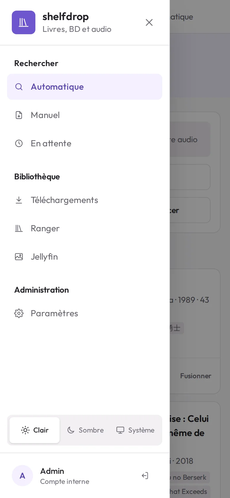</a>
  &nbsp;
  <a href="docs/screenshots/mobile-downloads.webp">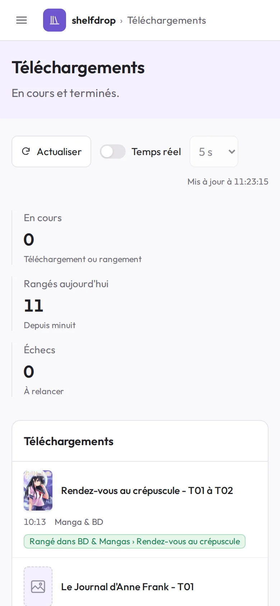</a>
</p>

How to take them again: [CONTRIBUTING.md](CONTRIBUTING.md#screenshots).

## Features

- **Work search** across MangaUpdates, Kitsu, MyAnimeList, AniList and MangaDex for manga, and the BnF, Open Library and Wikidata for books: one result per work, with every name it is known by and its cover.
- **Release search** in Prowlarr under each name of the work, scored by your filters, ranked by your trackers, in the categories you choose for each indexer.
- **Downloads** sent to qBittorrent (directly or through [qui](https://github.com/autobrr/qui)), Deluge or Transmission, followed live, sent again when a torrent did not arrive.
- **Automatic placement**: volumes renamed and hard-linked into the right library (manga and comics, books, audiobooks), MP3 tracks merged into one M4B with its chapters and cover, metadata written and locked in Jellyfin.
- **Place** (Ranger in French): the files shelfdrop could not place alone, linked by hand to a work, a volume or chapters, or ignored; files uploaded from the browser land there too.
- **Jellyfin page**: the series of your libraries, their volumes and missing numbers, each file downloadable and editable, and a forced sync of the metadata.
- **Waiting list**: searches kept and run again until a release shows up.
- **Discord journal** of the sends, downloads and placements, with covers, in English or in French.
- **Accounts**: one internal administrator account, and the administrators of your Jellyfin server.
- **API and MCP server** with access tokens (read, or read and download), documented in OpenAPI with Swagger UI at `/api/docs`.
- **Guided first launch** from the browser: the account, Prowlarr, the torrent client, Jellyfin, the libraries.
- Pages in English and in French, the language chosen on each device (the browser's by default); pages that work on a phone, settings changed live, logs readable from the settings.

## Requirements

- Docker with Compose.
- Prowlarr, a torrent client and Jellyfin, reachable from the shelfdrop containers. The torrent client: qBittorrent, directly or through qui; Deluge 2 with its plugin Label enabled; or Transmission 3.00 or later ([installation](docs/installation.md#the-torrent-client)).
- One folder holding both the torrents of the client and your book libraries, seen by the client at the same path as by shelfdrop, so that placement can use hard links.

## Quick start

```bash
git clone <repository> shelfdrop && cd shelfdrop
cp .env.example .env && chmod 600 .env
# In .env: SHELFDROP_CONTACT (an address the metadata sources can reach you at),
# SHELFDROP_SECRET_KEY (openssl rand -base64 32), SHELFDROP_MEDIA_DIR (the media folder)
docker compose --env-file .env -f docker/compose.yaml up -d --build --wait
```

Open `http://127.0.0.1:8000`. The first launch walks you through the set-up: create the internal account, connect Prowlarr, the torrent client and Jellyfin, then pick the libraries. Put a reverse proxy with TLS in front of it before exposing it: [installation](docs/installation.md) lists what shelfdrop expects from it.

## Documentation

| Page | What it covers |
| --- | --- |
| [Installation](docs/installation.md) | Docker, the placement worker, permissions, the database, the reverse proxy, upgrades |
| [Configuration](docs/configuration.md) | Every `SHELFDROP_*` variable and the settings of the page |
| [How it works](docs/how-it-works.md) | Work search, release search, downloads, placement, the journal |
| [API](docs/api.md) | Every route, its answers and error codes; the [OpenAPI document](docs/openapi.public.json) |
| [MCP client](docs/mcp-client.md) | Connecting an assistant or a script through the MCP server |
| [Decisions](docs/adr/) | Why shelfdrop is built the way it is |

## Contributing

[CONTRIBUTING.md](CONTRIBUTING.md) covers the development set-up, the tests and the commit rules.

## License

[MIT](LICENSE)
